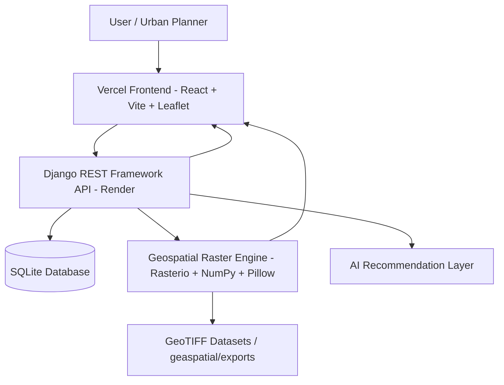

# HeatShieldAI

> **Production-ready geospatial AI platform for analyzing and mitigating urban heat risk using satellite-derived environmental indicators and intelligent recommendations.**

🌐 **Live Web Application:** [heatshield-ai-sand.vercel.app](https://heatshield-ai-sand.vercel.app/)  
⚙️ **Live Backend API:** [heatshield-api.onrender.com](https://heatshield-api.onrender.com)

---

## Overview

Urban areas experience significantly higher temperatures than their rural surroundings due to human activity, dense concrete infrastructure, and low vegetation cover—a phenomenon known as the **Urban Heat Island (UHI)** effect. Extreme surface temperatures directly impact public health, energy consumption, and urban livability.

**HeatShieldAI** bridges satellite Earth observation data and urban climate planning. By evaluating high-resolution satellite-derived indices (**NDVI**, **NDBI**, **NDWI**, and **LST**), HeatShieldAI computes city-level heat risk scores, generates colorized raster overlays, and delivers natural-language, data-driven AI recommendations for targeted urban heat mitigation strategies.

---

## Key Features

- 🌆 **City-Level Heat Risk Analysis:** Real-time environmental metrics and risk statistics for major Indian metropolises.
- 🛰️ **Satellite Environmental Indicators:** Quantitative tracking of NDVI (Vegetation), NDBI (Built-up), NDWI (Water), and LST (Surface Temperature).
- 🗺️ **Interactive Raster Visualization:** Full-screen Leaflet geospatial map overlays displaying GeoTIFF heat-risk layers with customized color scales.
- 🤖 **AI-Powered Recommendation Engine:** Automated interpretation of environmental indices into actionable mitigation plans (tree canopy growth, cool roofs, water body restoration, heatwave emergency alerts).
- 📊 **Analytics & Multi-City Comparison:** Comparative side-by-side dashboards analyzing environmental performance across cities.
- 📑 **Exportable Heat Risk Reports:** Automated report generation featuring environmental metrics, breakdown charts, and executive summaries.
- ⚡ **RESTful API Service:** Production-ready Django REST Framework API backing both data processing and raster streaming.

---

## Supported Cities

| City | State / Region | Availability |
| :--- | :--- | :--- |
| **Ahmedabad** | Gujarat | Live Analysis & GeoTIFF Raster Overlays |
| **Bengaluru** | Karnataka | Live Analysis & GeoTIFF Raster Overlays |
| **Delhi** | Delhi (NCT) | Live Analysis & GeoTIFF Raster Overlays |
| **Hyderabad** | Telangana | Live Analysis & GeoTIFF Raster Overlays |
| **Mumbai** | Maharashtra | Live Analysis & GeoTIFF Raster Overlays |

---

## How It Works

1. **User Interaction:** Users select a city on the React web dashboard to inspect heat hotspots, environmental indices, and geospatial overlays.
2. **REST API Request:** The frontend queries the Django backend endpoints (`/api/cities/`, `/api/analysis/<city>/`, `/api/ai-recommendation/<city>/`).
3. **Database & Index Lookup:** Django retrieves stored city statistics and environmental indices or accesses fallback city data structures.
4. **Geospatial Processing:** The backend raster engine uses `rasterio`, `numpy`, and `Pillow` to read GeoTIFF rasters from `geaspatial/exports/`, calculate bounds in `EPSG:4326`, and render dynamic RGBA PNG overlays.
5. **AI Recommendation Layer:** The recommendation engine evaluates index thresholds to compute mitigation percentages and generate natural-language action guidelines.
6. **Insight Presentation:** The client renders interactive maps, metric cards, charts, and downloadable reports.

---

## Environmental Indicators

| Indicator | Full Name | Description & Urban Significance |
| :--- | :--- | :--- |
| **NDVI** | Normalized Difference Vegetation Index | Measures canopy density and green vegetation cover. Higher values indicate cooling green infrastructure. |
| **NDBI** | Normalized Difference Built-up Index | Quantifies concrete, asphalt, and built-up land density. Higher values correlate directly with heat absorption and UHI intensity. |
| **NDWI** | Normalized Difference Water Index | Detects surface water bodies, wetlands, and moisture presence. Higher values denote evaporative cooling capacity. |
| **LST** | Land Surface Temperature | Direct radiometric measure of ground surface heat (°C). Drives emergency heat action plan triggers when exceeding critical thresholds. |
| **Heat Risk** | Integrated Heat Risk Index | Combined metric synthesizing NDVI, NDBI, NDWI, and LST into normalized risk categories (Low, Moderate, High, Very High). |

---

## REST API Reference

The backend provides public JSON REST endpoints:

### Core Endpoints

- GET /api/  
  Returns API status and version information.
- GET /api/cities/  
  Lists all available supported cities with coordinates and states.
- GET /api/analysis/<city_name>/  
  Returns environmental indices, risk scores, hotspot percentage, and hotspot area for a specified city.
- GET /api/ai-recommendation/<city_name>/  
  Returns targeted mitigation percentages (tree plantation, cool roof, water body, emergency action) and natural-language recommendations.

### Geospatial & Raster Endpoints

- GET /api/raster-preview/<city_name>/<layer_name>/  
  Generates a Base64-encoded colorized PNG overlay and Leaflet map bounds for a specific GIS layer (heat-risk, 
dvi, 
dbi, 
dwi, etc.).
- GET /api/raster-image/<city_name>/<layer_name>/  
  Streams raw GeoTIFF files or image downloads for external GIS tools.

---

## System Architecture & Tech Stack

### Frontend
- **Framework:** React 18 + Vite
- **Mapping:** React Leaflet + Leaflet.js
- **Styling:** Custom Vanilla CSS with modern dark mode aesthetic
- **Deployment:** Vercel

### Backend
- **Framework:** Django 6 + Django REST Framework
- **Geospatial Processing:** Rasterio, NumPy, Pillow, Affine
- **Server:** Gunicorn + WhiteNoise
- **Deployment:** Render

---

## Local Development Setup

### Prerequisites
- Python 3.10+
- Node.js 18+
- Git LFS (for downloading GeoTIFF rasters)

### 1. Clone Repository & Pull Raster Datasets
`ash
git clone https://github.com/yajashkhamar-python/HeatShieldAI.git
cd HeatShieldAI
git lfs pull
`

### 2. Backend Setup
`ash
cd backend
python -m venv venv
# On Windows:
.\venv\Scripts\activate
# On Linux/macOS:
source venv/bin/activate

pip install -r requirements.txt
python manage.py migrate
python manage.py seed_cities
python manage.py runserver
`
The Django API will start at http://127.0.0.1:8000/.

### 3. Frontend Setup
`ash
cd ../frontend
npm install
npm run dev
`
The web application will open at http://localhost:5173/.

---

## License

This project is released under the **MIT License**.
